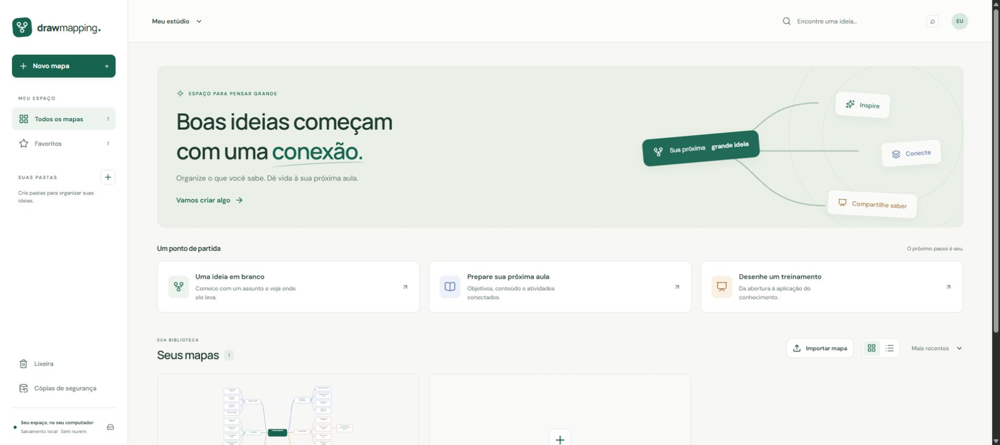
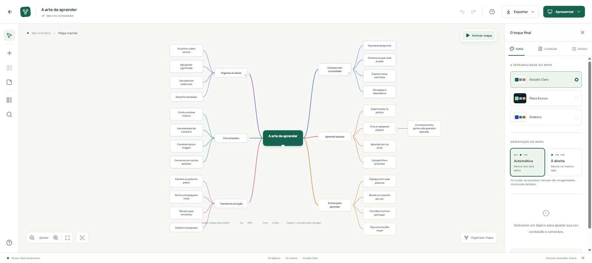
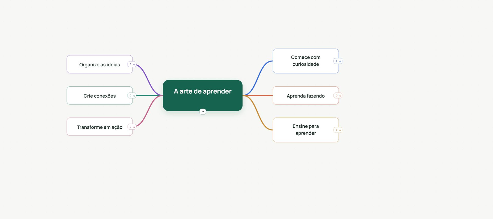

# DrawMapping

Estúdio de mapas mentais para criar, organizar e apresentar aulas. Executa no navegador, com servidor e dados no próprio computador.

## Instalar no Windows

1. No GitHub, clique em **Code → Download ZIP** e extraia a pasta para um local que você manterá no computador.
2. Dê dois cliques em **Install.bat** e aguarde. Ele baixa uma cópia local do Node.js, instala as dependências e cria o atalho. É necessário Windows de 64 bits e internet durante a instalação.
3. Abra o **DrawMapping** pelo atalho na área de trabalho. O servidor inicia minimizado e o navegador abre o aplicativo.

Não é necessário instalar Node.js, npm ou Git separadamente. Mantenha a pasta extraída no mesmo lugar: o atalho usa os arquivos dela. A instalação utiliza o Node.js fornecido pelo projeto oficial e confere o SHA-256 do arquivo baixado.

<details>
<summary>Instalação pelo terminal</summary>

Instale Node.js **24.11.1 ou superior** e Git, depois execute:

```powershell
git clone https://github.com/nvsolucoes/drawmapping.git
cd drawmapping
npm install
```

O instalador cria um atalho na área de trabalho. Se necessário, execute `node scripts/cli.mjs atalho` para criá-lo novamente. Para não criar o atalho automaticamente, defina `DRAWMAPPING_NO_SHORTCUT=1` antes de instalar. O pacote ainda não está publicado no npm.

</details>

## Abrir a partir da pasta de desenvolvimento

Dê duplo clique em **`Iniciar DrawMapping.bat`** na pasta do projeto. O navegador abre automaticamente. Mantenha a janela do servidor aberta durante o uso; pressione **Ctrl+C** nela para encerrar.

Você também pode usar **`Parar DrawMapping.bat`** depois de confirmar **Salvo no computador** na interface. Ele encerra somente a instância identificada do DrawMapping, sem afetar outros programas Node.

O endereço padrão é `http://127.0.0.1:4587`. Se a porta estiver ocupada, o servidor usa outra disponível e informa o endereço. Abrir o BAT novamente reutiliza a instância existente.

Requisitos: Windows, Chrome ou Edge e Node.js **24.11.1 ou superior**. Em um checkout novo, instale as dependências com `npm install`; a interface é compilada na preparação. `Preparar DrawMapping.bat` também permite preparar ou reconstruir o aplicativo. A abertura diária não executa npm e não baixa pacotes.

## Criar e apresentar

### Organize suas ideias

Crie mapas em branco, aulas ou treinamentos. Organize-os em pastas e alterne entre visualização em blocos e lista; a escolha fica salva no navegador. Use o menu de um mapa para movê-lo para outra pasta.



### Crie conexões

Selecione um tópico e use **Tab** para criar um filho, **Enter** para criar um irmão e **F2** ou duplo clique para editar. Arraste um tópico sobre outro para mudar a conexão; os subtópicos acompanham o ramo. Ao organizar o mapa, a ordem vertical definida entre irmãos é mantida.

Personalize cores, notas e imagens no painel de propriedades. Em **Estilo → Orientação do mapa**, distribua os ramos automaticamente ou coloque todos à direita. A mudança reorganiza posições manuais e pode ser desfeita.



### Apresente no seu ritmo

Em **Apresentar**, escolha **Apresentação livre** para abrir e fechar ramos na ordem que desejar, ou **Com roteiro** para avançar pelas etapas preparadas. A apresentação calcula o espaço usando os tópicos visíveis, sem alterar as posições salvas no editor. Pressione **Esc** para sair.



### Dê movimento às ideias

Use **Animar mapa** para revelar os ramos em sequência. Os tópicos também se reorganizam suavemente ao abrir ou fechar um ramo. As animações respeitam a preferência de movimento reduzido do sistema.


### Salve e compartilhe

Aguarde **Salvo** antes de fechar a aba. Exporte uma cópia editável **`.drawmap`** para transportar o mapa com suas imagens. PNG e SVG servem para materiais visuais; PDF usa o diálogo **Salvar como PDF** do navegador.

Após atualizar, confirme que os mapas estão salvos, encerre o servidor com `drawmapping parar` ou `Parar DrawMapping.bat` e abra novamente para carregar também o servidor atualizado. Os mapas permanecem na biblioteca.

## Onde os mapas ficam

Por padrão: `%LOCALAPPDATA%\DrawMapping`.

O banco `library.sqlite`, suas imagens e backups ficam separados desta pasta de código. Limpar os dados do navegador não apaga a biblioteca. Apagar a pasta de dados do DrawMapping remove a biblioteca; guarde backups em outro dispositivo se quiser proteção contra falha do computador.

Use **Backups** na aplicação para criar, baixar e restaurar uma cópia completa. Restaurar preserva uma cópia da biblioteca anterior. A lixeira permite recuperar mapas removidos. O histórico registra checkpoints limitados; não é um histórico ilimitado de cada tecla.

Não copie apenas `library.sqlite` enquanto o servidor está aberto: o SQLite também usa arquivos de transação. Prefira o backup gerado pela aplicação.

## Offline e limites

Fontes, ícones, interface e imagens importadas ficam locais. Criar, editar, apresentar, salvar e exportar não dependem de APIs externas. O servidor escuta somente em `127.0.0.1`; a aplicação não é publicada e não aceita acesso de outros computadores por padrão.

Imagens aceitas: PNG, JPEG e WebP, até 8 MB, 8.192 px por lado e 40 megapixels. O formato aceita até 5.000 tópicos e 128 níveis; mapas grandes podem exigir recolhimento de ramos e exportação SVG em vez de PNG. A impressão de um mapa extenso em uma única página reduz o texto; para aula, use o foco em ramos.

Arquivos `.drawmap`: até 64 MB compactados/128 MB expandidos. Backups completos: até 256 MB, incluindo imagens e histórico, e dois milhões de tópicos agregados. Ao exceder esses limites, a aplicação informa o problema antes de confirmar a criação; divida o material ou exporte mapas separadamente.

Node `24.11.1` inclui SQLite embutido e pode exibir um aviso `ExperimentalWarning` no terminal. O banco usa transações e não precisa de servidor de banco nem addon nativo. O aviso não significa que o salvamento falhou; consulte o indicador da interface.

## Desenvolvimento e verificação

```powershell
npm.cmd ci
npm.cmd run build
npm.cmd start
```

```powershell
npm.cmd run lint
npm.cmd run typecheck
npm.cmd test
```

Para desenvolver a interface: iniciar a API com `npm.cmd run serve` e, em outro terminal, `npm.cmd run dev`.

Configuração opcional por variáveis de ambiente: `DRAWMAPPING_DATA_DIR` para uma biblioteca alternativa em disco local e `DRAWMAPPING_PORT` para a porta preferida. `DRAWMAPPING_NO_OPEN=1` inicia sem abrir o navegador. No uso normal não é necessário configurar nada.

## Licença

O código do DrawMapping é disponibilizado sob a [licença MIT](LICENSE). As licenças dos componentes de terceiros estão em [public/third-party-licenses.txt](public/third-party-licenses.txt).
